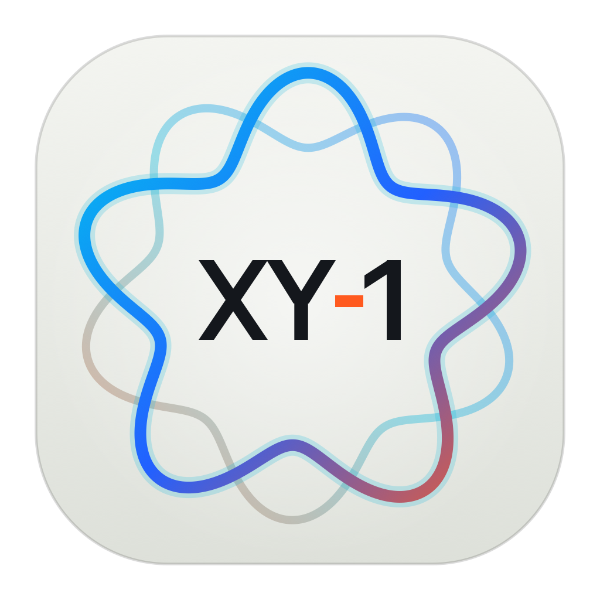
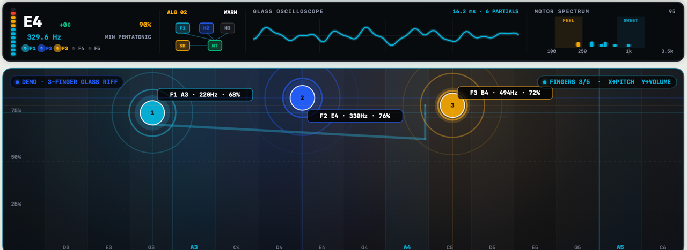

<p align="center">
  
</p>

<h1 align="center">XYNTH-1</h1>

<p align="center">
  <strong>Play your Apple Silicon MacBook’s Force Touch trackpad like a 5-finger tactile XY synthesizer — zero speakers used.</strong>
</p>

<p align="center">
  <a href="https://mj0lken.github.io/xynth-1/">Live Web Preview &amp; Demo</a> ·
  <a href="https://github.com/mj0lken/xynth-1/releases/latest">Download for Apple Silicon</a> ·
  <a href="#keyboard-shortcuts">Shortcuts</a> ·
  <a href="#signed--notarized-releases">Release Signing</a>
</p>

<p align="center">
  
</p>

---

Inspired by [os6/nospeaker](https://github.com/os6/nospeaker), **XYNTH-1** drives the Taptic Engine inside an **Apple Silicon** MacBook Force Touch trackpad (or Magic Trackpad 2/3) directly via macOS’s private `MultitouchSupport.framework`, turning the glass itself into a polyphonic instrument you **hear and feel directly in your fingertips**.

## Highlights

- **100% Trackpad Sound & Fingertip Feedback** — Mute your Mac (`F10`) and XYNTH-1 still sings and resonates straight from the trackpad glass. Includes a live CoreAudio mute-verification LED and a 1-click **`DEMO`** musical showcase.
- **Full 5-Finger Multi-Touch Polyphony** — Recognizes up to **5 simultaneous fingers** (`F1`–`F5` LED bank) with a 32 ms anti-flicker grace window and guaranteed fundamental preservation across all 5 fingers.
- **OP-1 × M-VAVE FM-1 Hardware Interface & 8 Themes (`C`)** — Machined color-coded rotary encoders (drag / scroll / double-click reset), illuminated tactile LED keycaps, recessed OLED with live FM-style harmonic algorithm schematic, oscilloscope, motor spectrum, and 8 industrial colorways (*OP-1 Field*, *80s Tech*, *Dieter White*, *Obsidian*, *Neon Cyber*, *Inca Gold*, *Acid Modern*, *Koto Clay*).
- **Expandable Ferrofluid Visualizer Bay (`V`)** — Snaps out a right-hand modular rack featuring a real-time 60 fps **liquid magnetic ferrofluid** visualizer (`SPIKES`, `ORBIT`, `CYMATIC`), `MAGNET` / `VISCOS` / `LFO HZ` knobs, 1-click Tactile Patches, and live `P1–P6` partial telemetry.
- **Audio Out / Screen Recording Mirror (`A`)** — Mirrors the live synth cleanly to macOS Speakers, headphones, or virtual recording buses (e.g. BlackHole / OBS) so screen recordings capture full-bandwidth sound while your trackpad keeps vibrating.
- **3D-Flip Rear Service Panel (`⚙` / `⌘,`)** — Flip the chassis over for 1-click deep-links into **macOS System Settings → Trackpad → More Gestures** (to disable conflicting 4/5-finger gestures) and built-in **GitHub Releases Auto-Updates**.

---

## Install (Apple Silicon Only)

### Download Prebuilt App
1. Grab **`XYNTH-1-v0.2.1-arm64.zip`** from the [latest GitHub Release](https://github.com/mj0lken/xynth-1/releases/latest).
2. Unzip and move **`XYNTH-1.app`** to `/Applications` (if using an ad-hoc build, right-click → **Open** on first launch).

### Build from Source
Requires an **Apple Silicon Mac (`arm64`)**, **macOS 14+**, and Xcode Command Line Tools (`xcode-select --install`):

```bash
git clone https://github.com/mj0lken/xynth-1.git
cd xynth-1
./scripts/run.sh
```

Run tests or build a local Apple Silicon release archive:

```bash
swift test
./scripts/build-app.sh release --zip
```

---

## Signed & Notarized Releases

XYNTH-1 includes a built-in Apple Silicon (`arm64`) signing, Hardened Runtime, Apple Notary Service, and stapling pipeline:

1. **Install a `Developer ID Application` certificate** in your Keychain (Xcode → *Settings* → *Accounts* → your Apple Developer team → *Manage Certificates* → `+` → *Developer ID Application*).
2. **Store a `notarytool` keychain profile once** (using an App-Specific Password from [account.apple.com](https://account.apple.com)):
   ```bash
   xcrun notarytool store-credentials xynth-1 --apple-id <your-apple-id> --team-id <your-team-id>
   ```
3. **Run the release pipeline** (tests → `arm64` build → Hardened Runtime codesign → Apple notarization → stapler + `spctl` verify → `dist/XYNTH-1-v<ver>-arm64.zip` + `.sha256`):
   ```bash
   ./scripts/release.sh
   # Or also publish directly to GitHub Releases:
   ./scripts/release.sh --publish
   ```

To package an ad-hoc build without a Developer ID certificate:

```bash
./scripts/release.sh --unsigned
```

---

## Best Playing Experience

1. **Mute your Mac (`F10`)** and verify the green `0 SPK` LED lights up.
2. **Place your MacBook on a solid desk** — the desk amplifies the glass acoustics dramatically compared to your lap.
3. **Click `DEMO`** to feel and hear a 3-finger glass riff right away, or **press `Space`** to lock the cursor and glide up to 5 fingers lightly without clicking (`X` = pitch, `Y` = volume).
4. **For uninterrupted 5-finger chords**, click **`⚙`** (top right) → **Open Trackpad Settings ↗** and turn off conflicting multi-finger gestures under *More Gestures*.

---

## Keyboard Shortcuts

| Key | Action |
|---|---|
| `Space` | Toggle Cursor-Locked Play Mode |
| `Esc` | Unlock Play Mode / Flip back from Settings / Stop Hold |
| `Hold ⌥` | Momentary trackpad play without locking cursor |
| `1` – `7` | Switch Timbre (`Sine`, `Warm`, `Hollow`, `Saw`, `Fifth`, `Bell`, `Voice`) |
| `[` / `]` | Octave Down / Up |
| `S` | Cycle Musical Scale |
| `M` | Cycle Axis Mapping (`XY P+V` / `Press+Tone` / `Press+Vibrato`) |
| `H` | Toggle Tactile Sub-Feel |
| `A` | Toggle Audio Out (Speakers / Recording Mirror) |
| `C` | Cycle 8 Hardware Chassis Themes |
| `V` | Expand / Collapse Ferrofluid Side Bay |
| `Tab` | Toggle Hold / Drone Latch |
| `↑` / `↓` | Adjust Master Volume |
| `←` / `→` | Adjust Vibrato Depth |
| `T` | Play 98 Hz → 3.6 kHz Trackpad Frequency Sweep |
| `⌘,` | Flip Window to Settings & Auto-Update Panel |

---

## Requirements & Hardware Safety

- **Apple Silicon Mac (`M1–M5`, `arm64`)** with a **Force Touch trackpad** or Magic Trackpad 2/3 running **macOS 14+**.
- **Actuator Safety**: XYNTH-1 strictly normalizes multi-partial tone amplitudes to sum to `1.0`, clamps frequencies within `45–4,150 Hz`, caps concurrent tones at `6`, and never drives the actuator above its normal `1.0` maximum.
- Uses Apple’s private `MultitouchSupport.framework` resolved dynamically at runtime (`dlopen`/`dlsym`); future macOS updates could alter private symbols.

## License

MIT — see [LICENSE](LICENSE).
